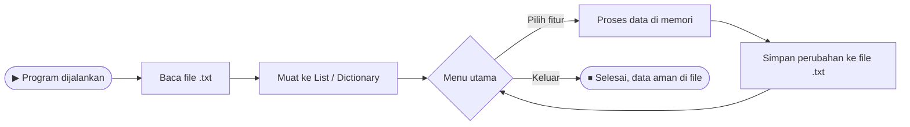
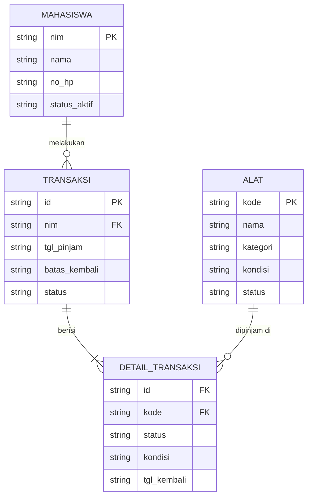
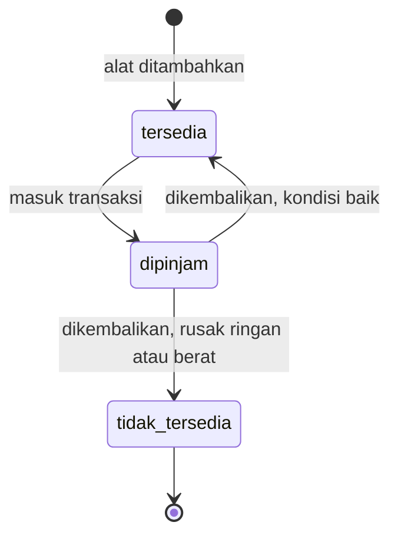
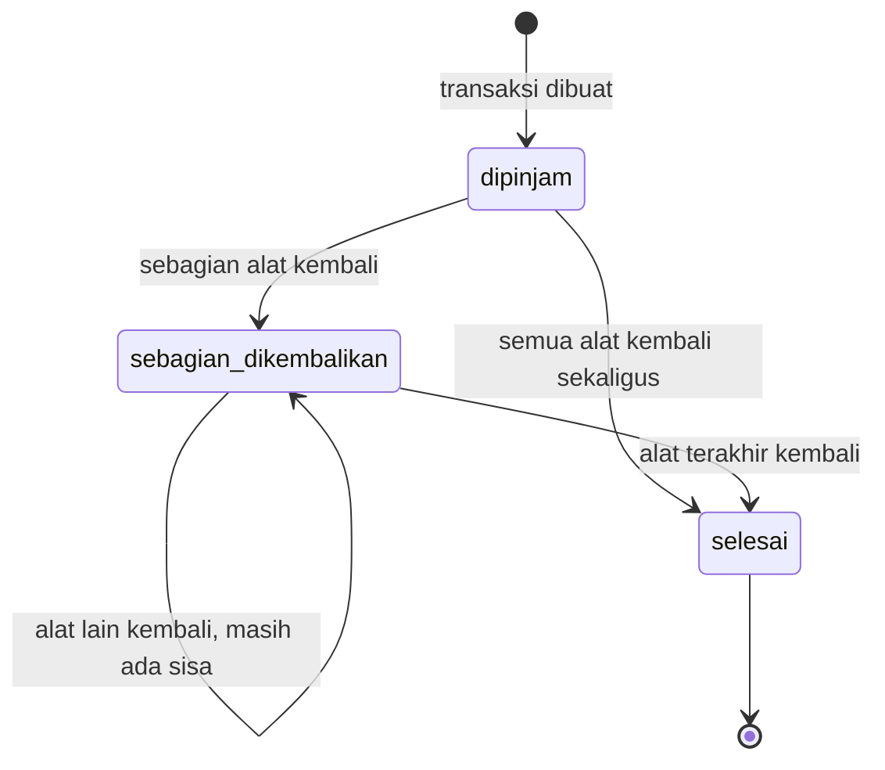
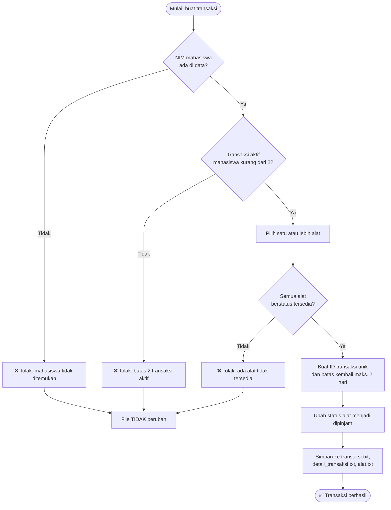
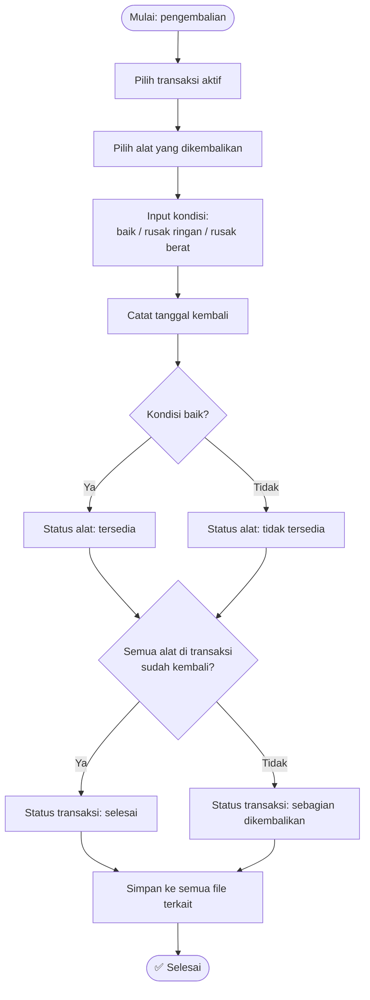
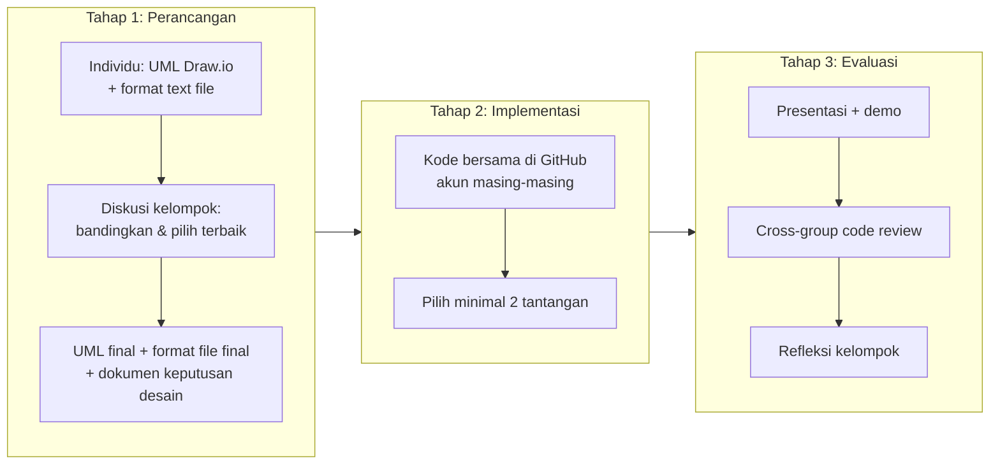
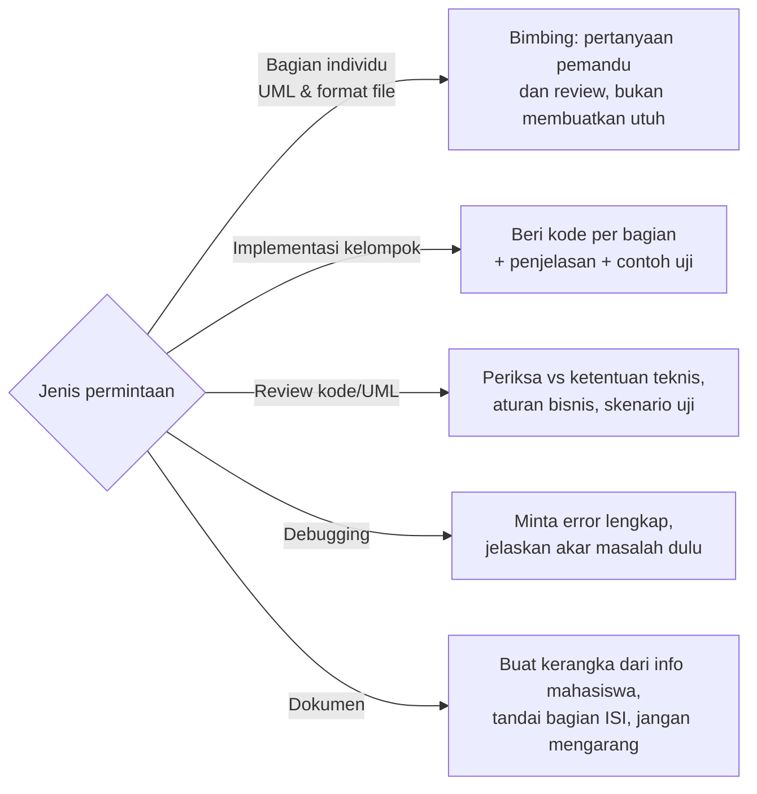
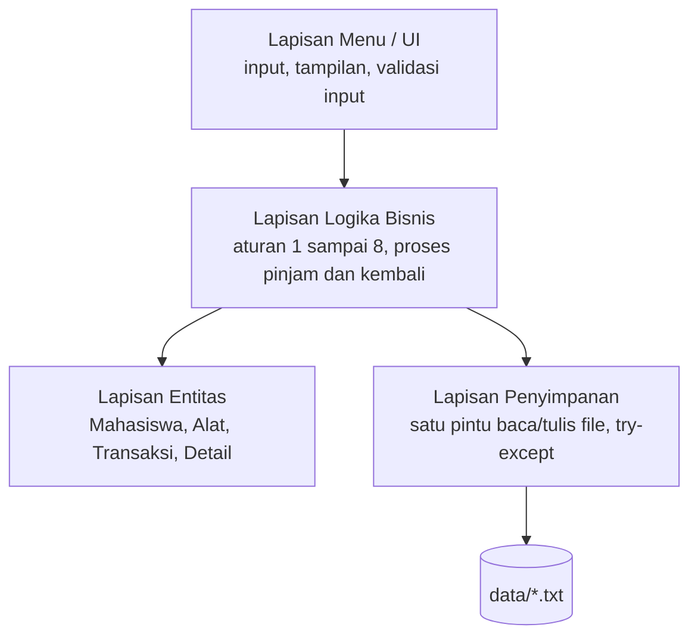

# 🔬 Panduan Proyek II: Sistem Peminjaman Peralatan Laboratorium

**Mata kuliah:** Praktikum Pemrograman Dasar
**Teknologi:** Python · OOP · List/Dictionary · Text file (`.txt`)
**Bentuk kerja:** Kelompok (GitHub) + tugas individu di awal

> 💡 **Cara membaca panduan ini:** mulai dari bagian 1 (gambaran besar), lihat diagram, lalu kerjakan sesuai checklist di bagian 10. Diagram memakai Mermaid, otomatis tampil di GitHub, VS Code (ekstensi Markdown Mermaid), dan Notion.

---

## 📑 Daftar Isi

1. [Gambaran Besar](#1--gambaran-besar)
2. [Boleh vs Dilarang](#2--boleh-vs-dilarang)
3. [Data & Hubungan Antar-File](#3--data--hubungan-antar-file)
4. [Siklus Hidup Alat & Transaksi](#4--siklus-hidup-alat--transaksi)
5. [Alur Peminjaman & Pengembalian](#5--alur-peminjaman--pengembalian)
6. [8 Aturan Bisnis](#6--8-aturan-bisnis)
7. [Fitur Menu & Tantangan](#7--fitur-menu--tantangan)
8. [Alur Pengerjaan 3 Tahap](#8--alur-pengerjaan-3-tahap)
9. [9 Skenario Pengujian](#9--9-skenario-pengujian)
10. [Checklist & Pembagian Tugas](#10--checklist--pembagian-tugas)
11. [Panduan untuk Claude](#11--panduan-untuk-claude-asisten-proyek)

---

## 1. 🧭 Gambaran Besar

**Masalah:** peminjaman alat lab masih dicatat manual, sehingga status alat tidak jelas, riwayat sulit dilacak, keterlambatan dan kondisi alat tidak tercatat, dan data hilang saat aplikasi ditutup.

**Solusi:** aplikasi Python berbasis menu yang menyimpan data permanen ke file `.txt`.



**Pegangan utama:** data di memori harus **selalu sama** dengan data di file, dan operasi yang ditolak **tidak boleh mengubah file**.

---

## 2. ✅ Boleh vs ❌ Dilarang

| ✅ Wajib / Boleh | ❌ Dilarang |
|---|---|
| Python + **OOP**, lebih dari **1 class** | Database (MySQL, SQLite, PostgreSQL, MongoDB, dll.) |
| **List / Dictionary** sebagai struktur data utama | Modul siap pakai: **`pickle`, `shelve`, `json`, `csv`** |
| File `.txt` untuk penyimpanan permanen | Variabel terpisah per alat (misal `alat1`, `alat2`) |
| `open()` + **`with`** | Kode baca/tulis file yang diulang di tiap menu |
| **`try-except`** saat baca/tulis file | Mengerjakan semua kode lewat **satu akun GitHub** |
| Parsing manual: `split()`, `strip()`, `join()` | |

> 📌 Semua operasi file dipusatkan di **satu tempat** (satu class/modul), lalu dipanggil oleh semua menu.

---

## 3. 🗂 Data & Hubungan Antar-File

### 3.1 Empat file minimal

| File | Isi | Contoh format (pemisah `\|`) |
|---|---|---|
| `mahasiswa.txt` | Data mahasiswa | `NIM\|nama\|no_hp\|status_aktif` |
| `alat.txt` | Data peralatan | `kode\|nama\|kategori\|kondisi\|status` |
| `transaksi.txt` | Header transaksi | `id\|nim\|tgl_pinjam\|batas_kembali\|status` |
| `detail_transaksi.txt` | Alat per transaksi + pengembalian | `id\|kode\|status\|kondisi\|tgl_kembali` |

Contoh isi:

```text
# mahasiswa.txt
M001|Andi Pratama|081234567890|aktif

# alat.txt
A001|Kamera Digital|perangkat multimedia|baik|dipinjam
A003|Kabel LAN|perangkat jaringan|rusak berat|tidak tersedia

# transaksi.txt
T001|M001|2026-08-10|2026-08-17|sebagian dikembalikan

# detail_transaksi.txt
T001|A001|dipinjam|-|-
T001|A003|dikembalikan|rusak berat|2026-08-12
```

> Format ini hanya contoh. Kelompok boleh menentukan sendiri nama file, urutan kolom, dan pemisah, **asal konsisten dan didokumentasikan di README**.

### 3.2 Relasi antar-data



📌 **Aturan keterkaitan:** `nim` dan `kode` di file transaksi harus ada di file mahasiswa dan file alat. ID transaksi, NIM, dan kode alat **tidak boleh ganda**, termasuk setelah program dijalankan ulang.

### 3.3 Ketentuan saat load dan save

| Situasi | Perilaku yang benar |
|---|---|
| File belum ada | Buat otomatis, **tanpa error** |
| File kosong | Program tetap jalan |
| Ada baris berformat salah (misal kolom kurang) | **Lewati baris**, tampilkan ⚠️ peringatan, program lanjut |
| Ada perubahan data (tambah/edit/hapus/transaksi/pengembalian) | **Langsung tulis ke file** |

---

## 4. 🔄 Siklus Hidup Alat & Transaksi

### 4.1 Status alat



| Kondisi saat dikembalikan | Dihitung tersedia? |
|---|---|
| ✅ Baik | **Ya**, langsung kembali ke stok |
| ⚠️ Rusak ringan | **Tidak** |
| ❌ Rusak berat | **Tidak** |

### 4.2 Status transaksi



> 📌 Transaksi **tetap dianggap aktif** sampai **semua** alatnya dikembalikan.

---

## 5. 🔀 Alur Peminjaman & Pengembalian

### 5.1 Membuat transaksi peminjaman



### 5.2 Memproses pengembalian



---

## 6. 📜 8 Aturan Bisnis

| # | Aturan | Singkatnya |
|---|---|---|
| 1 | **Ketersediaan alat** | Alat tidak tersedia tidak bisa dipinjam |
| 2 | **Batas peminjaman** | Maks. **2 transaksi aktif** per mahasiswa |
| 3 | **Isi transaksi** | Satu transaksi bisa berisi banyak alat, pakai List/Dict (bukan variabel terpisah) |
| 4 | **Pengembalian sebagian** | Boleh, transaksi aktif sampai semua kembali |
| 5 | **Kondisi alat** | Hanya kondisi `baik` yang kembali tersedia |
| 6 | **Penghapusan data** | Mahasiswa/alat **tidak boleh dihapus** jika masih ada di transaksi aktif |
| 7 | **Konsistensi data** | Data program sama dengan file; operasi yang ditolak tidak mengubah file |
| 8 | **Keterkaitan antar-file** | NIM/kode harus merujuk data yang ada; ID/NIM/kode tidak boleh duplikat |

---

## 7. 🧩 Fitur Menu & Tantangan

### 7.1 Menu minimal

```text
╔══════════════════════════════════════════════╗
║        SISTEM PEMINJAMAN ALAT LAB            ║
╠══════════════════════════════════════════════╣
║  1. Kelola mahasiswa (tambah/edit/hapus/cari)║
║  2. Kelola alat (tambah/edit/hapus/cari)     ║
║  3. Buat transaksi peminjaman                ║
║  4. Tampilkan transaksi                      ║
║  5. Proses pengembalian alat                 ║
║  6. Cari transaksi berdasarkan mahasiswa     ║
║  7. Tampilkan alat tersedia                  ║
║  8. Tampilkan alat sedang dipinjam           ║
║  9. Tampilkan alat rusak                     ║
║ 10. Riwayat peminjaman mahasiswa             ║
║  0. Keluar (semua data tersimpan)            ║
╚══════════════════════════════════════════════╝
```

Menu boleh dikembangkan sesuai rancangan kelompok.

### 7.2 Tantangan (pilih minimal 2)

| Kode | Tantangan | Intinya | File baru |
|---|---|---|---|
| **A** | 🔎 Pencarian fleksibel | Cari alat via kode, sebagian nama, atau kategori | — |
| **B** | 📊 Statistik | Alat & mahasiswa paling sering, jumlah transaksi selesai/aktif | — |
| **C** | 🔧 Pemeliharaan | Alat rusak berat masuk daftar perbaikan, lalu bisa tersedia lagi | `pemeliharaan.txt` |
| **D** | 📝 Log aktivitas | Catat aktivitas dengan **mode append** | `log.txt` |
| **E** | 💾 Backup & restore | Salin data ke folder `backup_YYYY-MM-DD`, bisa dipulihkan | folder `backup_*` |
| **F** | 📄 Ekspor laporan | Laporan `.txt` rapi (alat dipinjam, alat rusak, riwayat mahasiswa) | file laporan |

> Tantangan adalah **tambahan** setelah kebutuhan dasar selesai.

---

## 8. 🚀 Alur Pengerjaan 3 Tahap



### 8.1 Tahap 1: Perancangan

| Level | Yang dikerjakan |
|---|---|
| 👤 **Individu** (mandiri) | UML Class Diagram di **Draw.io** (class, atribut, method utama, hubungan, tanggung jawab, class/method baca-tulis file) **+** rancangan format file (nama file, kolom & pemisah, **min. 2 baris contoh per file**, kapan baca dan kapan tulis) |
| 👥 **Kelompok** | Bandingkan rancangan, catat kelebihan dan kekurangan, pilih atau gabungkan yang terbaik, hasilkan **1 UML final** dan **1 format file final** |
| 📄 **Dokumen Keputusan Desain** | Rancangan dasar yang dipakai · bagian yang diambil dari anggota lain · alasan struktur class · alasan format & pemisah · alternatif yang tidak dipilih |

🎯 **Pertanyaan yang harus bisa dijawab tiap anggota:** *Mengapa struktur class dan format file ini dipilih, dan bagaimana class-class bekerja sama menyelesaikan masalah serta menjaga data tetap tersimpan?*

### 8.2 Tahap 2: Implementasi

Setiap anggota **wajib berkontribusi** lewat akun GitHub masing-masing. Bentuk kontribusi: membuat class, mengembangkan fitur, membuat fungsi baca/tulis file, validasi input, testing, memperbaiki bug, refactoring, dokumentasi.

Struktur repository minimal:

```text
nama-repo/
├── README.md          ← wajib lengkap
├── main.py
├── <folder/module program>/
│   └── ...
├── data/              ← file .txt
│   ├── mahasiswa.txt
│   ├── alat.txt
│   ├── transaksi.txt
│   └── detail_transaksi.txt
└── docs/              ← UML, desain, hasil uji, review, refleksi
```

README harus memuat: nama aplikasi · anggota · deskripsi sistem · struktur program · format tiap text file · cara menjalankan · pembagian kontribusi.

### 8.3 Tahap 3: Evaluasi

**Presentasi** menunjukkan: masalah yang diselesaikan · UML final · alasan struktur class · demo (termasuk **bukti data tetap ada setelah program ditutup dan dijalankan ulang**) · struktur List/Dict · format file & cara load · pembagian tugas · histori GitHub · kendala teknis · perubahan desain dari UML awal ke akhir.

**Cross-group code review**, 4 aspek:

| Aspek | Yang diperiksa |
|---|---|
| 1️⃣ Kesesuaian rancangan & implementasi | Class, atribut, method, relasi, dan format file sesuai UML dan README |
| 2️⃣ Ketepatan solusi | Program jalan, CRUD tersimpan, transaksi benar, status alat benar, pengembalian sebagian, aturan bisnis |
| 3️⃣ Pengelolaan file | Load benar, file = memori, tidak error saat file kosong/hilang, baris salah ditangani, pakai `with`, **tidak ada data ganda** setelah restart berulang |
| 4️⃣ Skalabilitas | Mudah dikembangkan? Efisien untuk 10.000 alat dan 20.000 mahasiswa? Mudah diganti database? Bagian mana yang sulit dipelihara? |

---

## 9. 🧪 9 Skenario Pengujian

| # | Skenario | Hasil yang diharapkan | Lulus? |
|---|---|---|---|
| 1 | Tambah beberapa mahasiswa & alat | Tercatat di `mahasiswa.txt` dan `alat.txt` | ☐ |
| 2 | Satu mahasiswa pinjam beberapa alat dalam satu transaksi | Status alat berubah di program **dan** file | ☐ |
| 3 | Pinjam alat yang tidak tersedia | **Ditolak**, isi file tidak berubah | ☐ |
| 4 | Kembalikan sebagian alat | Status alat, status transaksi, dan sisa alat dipinjam benar | ☐ |
| 5 | Alat kembali rusak ringan/berat | Alat **tidak** kembali tersedia | ☐ |
| 6 | Hapus mahasiswa yang punya transaksi aktif | **Ditolak** | ☐ |
| 7 | Tutup lalu jalankan ulang program | Semua data (termasuk transaksi sebagian dikembalikan) utuh | ☐ |
| 8 | Hapus/kosongkan satu file data | Tidak error, file dibuat ulang otomatis | ☐ |
| 9 | Tambah manual 1 baris berformat salah | Baris dilewati, muncul ⚠️ peringatan, program tetap jalan | ☐ |

---

## 10. ✔ Checklist & Pembagian Tugas

### 10.1 Artefak yang dikumpulkan

**👤 Individu**
- [ ] UML Class Diagram (Draw.io) tiap anggota
- [ ] Rancangan format text file tiap anggota

**👥 Kelompok**
- [ ] UML Class Diagram final
- [ ] Rancangan format text file final
- [ ] Dokumen keputusan desain
- [ ] URL repository GitHub
- [ ] Source code program
- [ ] Contoh data `.txt`: **min. 5 mahasiswa, 10 alat, 3 transaksi**
- [ ] README
- [ ] Dokumen hasil pengujian (9 skenario)
- [ ] Dokumen hasil cross-group code review
- [ ] Dokumen refleksi & rencana perbaikan

### 10.2 Tabel pembagian tugas (isi oleh kelompok)

| Anggota | Akun GitHub | Tanggung jawab utama | Status |
|---|---|---|---|
| [ISI] | [ISI] | [ISI: misal class Alat dan fitur kelola alat] | ☐ |
| [ISI] | [ISI] | [ISI: misal FileHandler dan validasi load] | ☐ |
| [ISI] | [ISI] | [ISI: misal transaksi dan pengembalian] | ☐ |
| [ISI] | [ISI] | [ISI: misal testing, README, dokumentasi] | ☐ |

### 10.3 Pertanyaan refleksi (setelah code review)

1. Apa kelemahan utama rancangan kelompok?
2. Bagian apa yang pertama diperbaiki jika menjadi sistem nyata?
3. Adakah class dengan terlalu banyak tanggung jawab?
4. Apakah struktur collection yang dipakai sudah tepat?
5. Apakah format text file mudah dibaca, diperbarui, dan dikembangkan?
6. Kelebihan dan kekurangan text file dibanding database?
7. Adakah duplikasi kode?
8. Bagaimana desain class diperbaiki agar lebih scalable?
9. Perubahan apa yang dilakukan setelah menerima hasil code review?

---

## 11. 🤖 Panduan untuk Claude (Asisten Proyek)

Bagian ini adalah instruksi bagi Claude saat dipakai kelompok untuk proyek ini.

**Peran:** asisten belajar dan pair-programmer. Jawab dalam **Bahasa Indonesia**. Utamakan pemahaman, jelaskan *mengapa* sebuah desain dipilih.



**Saat memberi kode:**
1. Nyatakan asumsi singkat (nama class, format file) bila belum ditentukan.
2. Berikan **per bagian** (satu class/fungsi), bukan seluruh aplikasi sekaligus kecuali diminta.
3. Patuhi larangan di bagian 2 (tanpa json/csv/pickle/database; wajib `with` dan `try-except`).
4. Sertakan docstring/komentar singkat dan contoh pemakaian.

**Saat mereview:** urutkan temuan **pelanggaran aturan > bug > desain/skalabilitas > gaya kode**, lalu beri saran konkret.

**Arah desain yang bisa didiskusikan** (bahan diskusi, bukan jawaban tunggal):



- **Satu pintu I/O:** semua `open()` ada di lapisan penyimpanan, menu hanya memanggil method.
- **Validasi dulu, baru simpan:** cek aturan bisnis, ubah memori, tulis file (menjaga Aturan 7).
- **Load defensif:** cek jumlah kolom, lewati baris rusak dengan peringatan, buat file bila belum ada.
- **Dictionary untuk pencarian cepat:** key `nim` atau `kode`.
- **Kategori dinamis:** simpan sebagai data, bukan `if/elif` kaku.
- **Hindari:** variabel global berlebihan, class yang menanggung terlalu banyak tugas, `int(input())` tanpa `try-except`.
