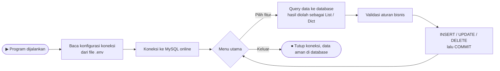
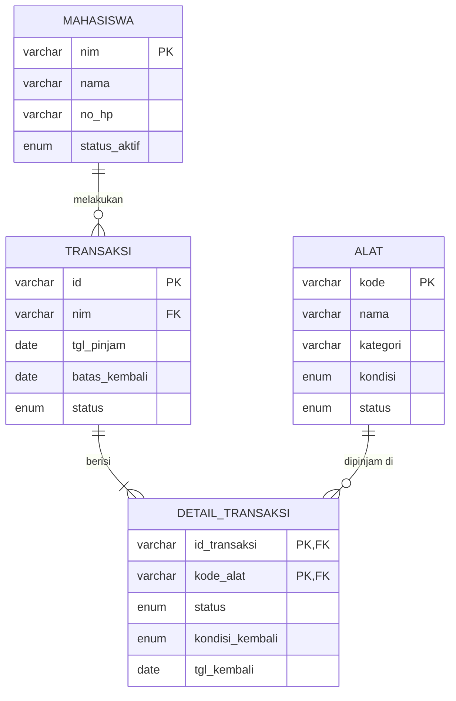
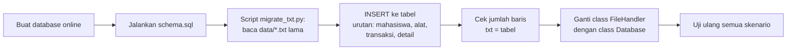
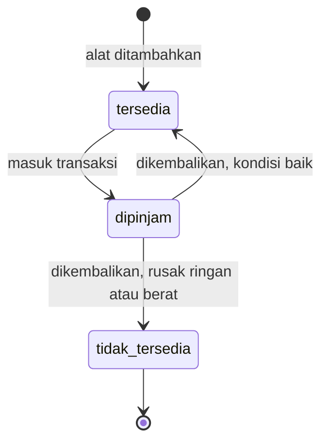
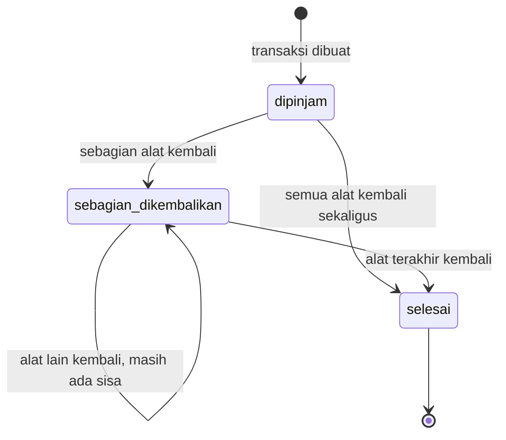
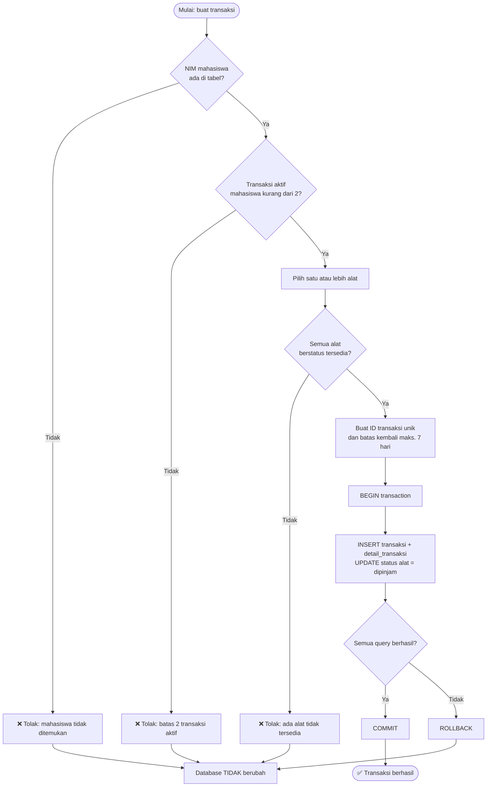
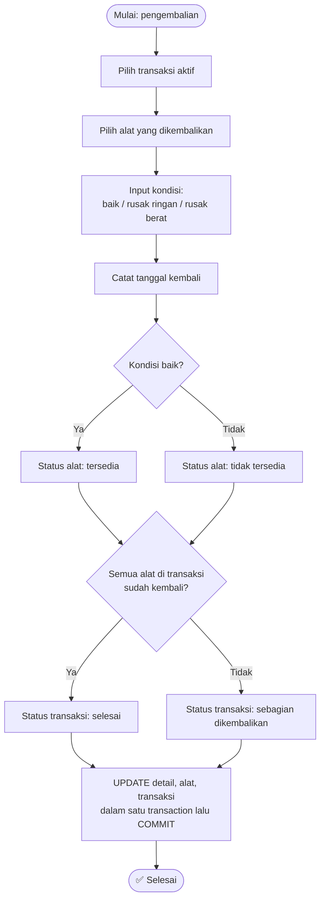
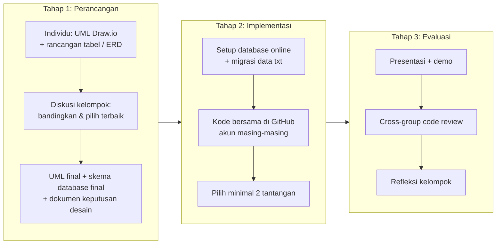
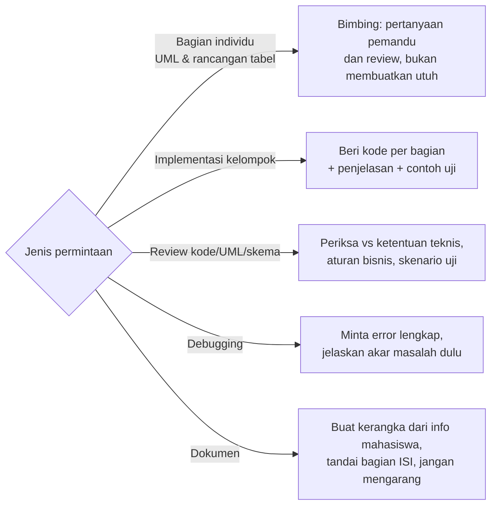
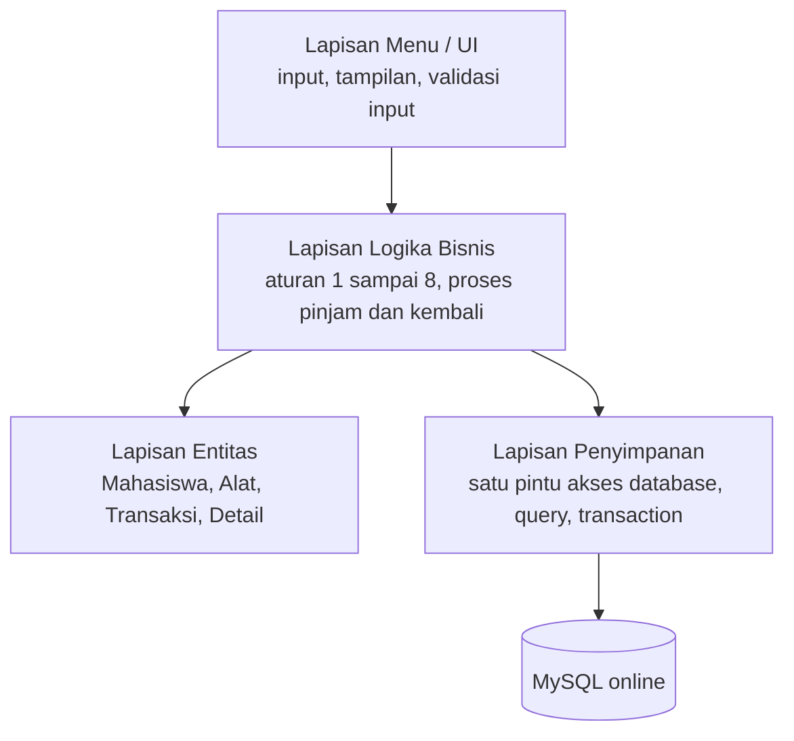

# 🔬 Panduan Proyek II: Sistem Peminjaman Peralatan Laboratorium

**Mata kuliah:** Praktikum Pemrograman Dasar
**Teknologi:** Python · OOP · List/Dictionary · **MySQL (database online)**
**Bentuk kerja:** Kelompok (GitHub) + tugas individu di awal

> 💡 **Cara membaca panduan ini:** mulai dari bagian 1 (gambaran besar), lihat diagram, lalu kerjakan sesuai checklist di bagian 10. Diagram memakai Mermaid, otomatis tampil di GitHub, VS Code (ekstensi Markdown Mermaid), dan Notion.

> 🔁 **Pembaruan (migrasi ke database):** versi awal proyek ini menyimpan data di file `.txt` dan melarang database. Sekarang penyimpanan **wajib dimigrasikan ke MySQL** yang di-hosting online (bisa diakses semua anggota kelompok). Aturan bisnis, menu, dan alur pinjam/kembali **tidak berubah**, yang berubah adalah lapisan penyimpanan. Lihat [bagian 3.4](#34-migrasi-dari-txt-ke-mysql) untuk langkah migrasi.

---

## 📑 Daftar Isi

1. [Gambaran Besar](#1--gambaran-besar)
2. [Boleh vs Dilarang](#2--boleh-vs-dilarang)
3. [Data, Tabel & Relasi](#3--data-tabel--relasi)
4. [Siklus Hidup Alat & Transaksi](#4--siklus-hidup-alat--transaksi)
5. [Alur Peminjaman & Pengembalian](#5--alur-peminjaman--pengembalian)
6. [8 Aturan Bisnis](#6--8-aturan-bisnis)
7. [Fitur Menu & Tantangan](#7--fitur-menu--tantangan)
8. [Alur Pengerjaan 3 Tahap](#8--alur-pengerjaan-3-tahap)
9. [10 Skenario Pengujian](#9--10-skenario-pengujian)
10. [Checklist & Pembagian Tugas](#10--checklist--pembagian-tugas)
11. [Panduan untuk Claude](#11--panduan-untuk-claude-asisten-proyek)

---

## 1. 🧭 Gambaran Besar

**Masalah:** peminjaman alat lab masih dicatat manual, sehingga status alat tidak jelas, riwayat sulit dilacak, keterlambatan dan kondisi alat tidak tercatat, dan data hilang saat aplikasi ditutup. Versi berbasis file `.txt` sudah menyelesaikan masalah penyimpanan, tetapi data hanya ada di komputer masing-masing anggota dan sulit dijaga konsistensinya.

**Solusi:** aplikasi Python berbasis menu yang menyimpan data permanen ke **database MySQL online**, sehingga semua anggota kelompok memakai data yang sama.



**Pegangan utama:** database adalah **satu-satunya sumber data yang benar**. Operasi yang ditolak **tidak boleh mengubah database**. Operasi yang menyentuh beberapa tabel sekaligus harus memakai **transaction** (`commit` jika semua berhasil, `rollback` jika ada yang gagal).

---

## 2. ✅ Boleh vs ❌ Dilarang

| ✅ Wajib / Boleh | ❌ Dilarang |
|---|---|
| Python + **OOP**, lebih dari **1 class** | Menyimpan data utama di file `.txt`, `json`, `csv`, `pickle`, atau `shelve` |
| **MySQL** online sebagai penyimpanan permanen | Menyusun query dengan f-string / `+` dari input user (rawan **SQL injection**) |
| Library `mysql-connector-python` atau `PyMySQL` | Menulis host, user, dan password langsung di kode atau meng-commit-nya ke GitHub |
| **Parameterized query** (`%s`) untuk semua input | Kode koneksi/query yang diulang di tiap menu |
| **`try-except`** saat koneksi dan query | ORM (SQLAlchemy, Django ORM, Peewee, dll.) |
| Transaction: `commit()` / `rollback()` | Variabel terpisah per alat (misal `alat1`, `alat2`) |
| **List / Dictionary** untuk mengolah hasil query di program | Mengerjakan semua kode lewat **satu akun GitHub** |
| `PRIMARY KEY`, `FOREIGN KEY`, `UNIQUE`, `NOT NULL` di tabel | |
| Konfigurasi koneksi di `.env` (dimasukkan ke `.gitignore`) | |

> 📌 Semua operasi database dipusatkan di **satu tempat** (satu class/modul, misal `Database` atau repository per entitas), lalu dipanggil oleh semua menu. Menu **tidak boleh** menulis SQL sendiri.

### 2.1 Database online yang disarankan (gratis)

| Layanan | Catatan |
|---|---|
| **Aiven for MySQL** (Free plan) ⭐ | MySQL asli, ±1 GB, tanpa kartu kredit. Bisa dimatikan otomatis jika lama tidak dipakai |
| **TiDB Cloud Serverless** | Kompatibel MySQL, kuota lebih besar, koneksi wajib SSL |

> 📘 Langkah lengkap setup Aiven sampai Python terkoneksi: [docs/panduan_setup_aiven.md](docs/panduan_setup_aiven.md).
>
> Kuota paket gratis bisa berubah. Cek halaman pricing sebelum mendaftar. Satu anggota membuat database, lalu membagikan detail koneksi ke anggota lain **lewat jalur pribadi** (bukan lewat repo).

---

## 3. 🗂 Data, Tabel & Relasi

### 3.1 Empat tabel minimal

| Tabel | Isi | Kolom (contoh) |
|---|---|---|
| `mahasiswa` | Data mahasiswa | `nim` PK, `nama`, `no_hp`, `status_aktif` |
| `alat` | Data peralatan | `kode` PK, `nama`, `kategori`, `kondisi`, `status` |
| `transaksi` | Header transaksi | `id` PK, `nim` FK, `tgl_pinjam`, `batas_kembali`, `status` |
| `detail_transaksi` | Alat per transaksi + pengembalian | `id_transaksi` FK, `kode_alat` FK, `status`, `kondisi_kembali`, `tgl_kembali` |

Contoh skema (`schema.sql`):

```sql
CREATE TABLE mahasiswa (
    nim          VARCHAR(20)  PRIMARY KEY,
    nama         VARCHAR(100) NOT NULL,
    no_hp        VARCHAR(20),
    status_aktif ENUM('aktif','nonaktif') NOT NULL DEFAULT 'aktif'
);

CREATE TABLE alat (
    kode     VARCHAR(20)  PRIMARY KEY,
    nama     VARCHAR(100) NOT NULL,
    kategori VARCHAR(50)  NOT NULL,
    kondisi  ENUM('baik','rusak ringan','rusak berat') NOT NULL DEFAULT 'baik',
    status   ENUM('tersedia','dipinjam','tidak tersedia') NOT NULL DEFAULT 'tersedia'
);

CREATE TABLE transaksi (
    id            VARCHAR(20) PRIMARY KEY,
    nim           VARCHAR(20) NOT NULL,
    tgl_pinjam    DATE NOT NULL,
    batas_kembali DATE NOT NULL,
    status        ENUM('dipinjam','sebagian dikembalikan','selesai') NOT NULL DEFAULT 'dipinjam',
    FOREIGN KEY (nim) REFERENCES mahasiswa(nim)
);

CREATE TABLE detail_transaksi (
    id_transaksi    VARCHAR(20) NOT NULL,
    kode_alat       VARCHAR(20) NOT NULL,
    status          ENUM('dipinjam','dikembalikan') NOT NULL DEFAULT 'dipinjam',
    kondisi_kembali ENUM('baik','rusak ringan','rusak berat') NULL,
    tgl_kembali     DATE NULL,
    PRIMARY KEY (id_transaksi, kode_alat),
    FOREIGN KEY (id_transaksi) REFERENCES transaksi(id),
    FOREIGN KEY (kode_alat)    REFERENCES alat(kode)
);
```

Contoh data awal (`seed.sql`):

```sql
INSERT INTO mahasiswa VALUES ('M001','Andi Pratama','081234567890','aktif');
INSERT INTO alat VALUES
  ('A001','Kamera Digital','perangkat multimedia','baik','dipinjam'),
  ('A003','Kabel LAN','perangkat jaringan','rusak berat','tidak tersedia');
INSERT INTO transaksi VALUES ('T001','M001','2026-08-10','2026-08-17','sebagian dikembalikan');
INSERT INTO detail_transaksi VALUES
  ('T001','A001','dipinjam',NULL,NULL),
  ('T001','A003','dikembalikan','rusak berat','2026-08-12');
```

> Skema ini hanya contoh. Kelompok boleh menentukan sendiri nama tabel, kolom, dan tipe data, **asal konsisten, ada di `schema.sql`, dan didokumentasikan di README**.

### 3.2 Relasi antar-tabel



📌 **Aturan keterkaitan:** dijaga oleh `FOREIGN KEY` (NIM dan kode alat di transaksi harus ada) dan `PRIMARY KEY` (ID transaksi, NIM, dan kode alat tidak bisa ganda). Program tetap **memvalidasi lebih dulu** agar pesan error ramah bagi user, bukan error mentah dari MySQL.

### 3.3 Ketentuan koneksi dan penyimpanan

| Situasi | Perilaku yang benar |
|---|---|
| Tabel belum ada | Dibuat otomatis (`CREATE TABLE IF NOT EXISTS`) atau lewat `schema.sql`, **tanpa error** |
| Tabel kosong | Program tetap jalan, menampilkan pesan "data kosong" |
| Koneksi gagal (internet mati, password salah, server tidur) | Tampilkan ⚠️ pesan jelas, program **tidak crash** |
| Input melanggar constraint (duplikat, FK tidak ada) | Ditangkap `try-except`, ditampilkan pesan ramah, tidak ada data berubah |
| Operasi menyentuh lebih dari 1 tabel (pinjam, kembali) | Satu **transaction**: semua berhasil lalu `commit`, atau `rollback` semua |
| Ada perubahan data | Langsung `commit` ke database |

Contoh `.env` (**jangan di-commit**, sediakan `.env.example` tanpa isi rahasia):

```text
DB_HOST=xxxx.aivencloud.com
DB_PORT=12345
DB_USER=avnadmin
DB_PASSWORD=********
DB_NAME=defaultdb
```

### 3.4 Migrasi dari `.txt` ke MySQL



- Urutan insert penting: tabel induk (`mahasiswa`, `alat`) **sebelum** tabel anak (`transaksi`, `detail_transaksi`) agar FK tidak gagal.
- Jika desain kelompok sudah memakai **satu pintu I/O**, migrasi cukup mengganti isi class penyimpanan, class lain dan menu hampir tidak berubah. Ini bukti desain yang baik.
- Script migrasi dijalankan **sekali**. Simpan di repo (folder `scripts/`) sebagai dokumentasi.

---

## 4. 🔄 Siklus Hidup Alat & Transaksi

### 4.1 Status alat



| Kondisi saat dikembalikan | Dihitung tersedia? |
|---|---|
| ✅ Baik | **Ya**, langsung kembali ke stok |
| ⚠️ Rusak ringan | **Tidak** |
| ❌ Rusak berat | **Tidak** |

### 4.2 Status transaksi



> 📌 Transaksi **tetap dianggap aktif** sampai **semua** alatnya dikembalikan.

---

## 5. 🔀 Alur Peminjaman & Pengembalian

### 5.1 Membuat transaksi peminjaman



### 5.2 Memproses pengembalian



---

## 6. 📜 8 Aturan Bisnis

| # | Aturan | Singkatnya |
|---|---|---|
| 1 | **Ketersediaan alat** | Alat tidak tersedia tidak bisa dipinjam |
| 2 | **Batas peminjaman** | Maks. **2 transaksi aktif** per mahasiswa |
| 3 | **Isi transaksi** | Satu transaksi bisa berisi banyak alat (banyak baris `detail_transaksi`), di program diolah dengan List/Dict |
| 4 | **Pengembalian sebagian** | Boleh, transaksi aktif sampai semua kembali |
| 5 | **Kondisi alat** | Hanya kondisi `baik` yang kembali tersedia |
| 6 | **Penghapusan data** | Mahasiswa/alat **tidak boleh dihapus** jika masih ada di transaksi aktif |
| 7 | **Konsistensi data** | Operasi yang ditolak atau gagal di tengah jalan **tidak mengubah database** (pakai `rollback`) |
| 8 | **Keterkaitan antar-tabel** | NIM/kode harus merujuk data yang ada (FK); ID/NIM/kode tidak boleh duplikat (PK) |

---

## 7. 🧩 Fitur Menu & Tantangan

### 7.1 Menu minimal

```text
╔══════════════════════════════════════════════╗
║        SISTEM PEMINJAMAN ALAT LAB            ║
╠══════════════════════════════════════════════╣
║  1. Kelola mahasiswa (tambah/edit/hapus/cari)║
║  2. Kelola alat (tambah/edit/hapus/cari)     ║
║  3. Buat transaksi peminjaman                ║
║  4. Tampilkan transaksi                      ║
║  5. Proses pengembalian alat                 ║
║  6. Cari transaksi berdasarkan mahasiswa     ║
║  7. Tampilkan alat tersedia                  ║
║  8. Tampilkan alat sedang dipinjam           ║
║  9. Tampilkan alat rusak                     ║
║ 10. Riwayat peminjaman mahasiswa             ║
║  0. Keluar (tutup koneksi database)          ║
╚══════════════════════════════════════════════╝
```

Menu boleh dikembangkan sesuai rancangan kelompok.

### 7.2 Tantangan (pilih minimal 2)

| Kode | Tantangan | Intinya | Tambahan |
|---|---|---|---|
| **A** | 🔎 Pencarian fleksibel | Cari alat via kode, sebagian nama (`LIKE`), atau kategori | — |
| **B** | 📊 Statistik | Alat & mahasiswa paling sering, jumlah transaksi selesai/aktif (`GROUP BY`, `COUNT`) | — |
| **C** | 🔧 Pemeliharaan | Alat rusak berat masuk daftar perbaikan, lalu bisa tersedia lagi | tabel `pemeliharaan` |
| **D** | 📝 Log aktivitas | Catat setiap aktivitas (siapa, apa, kapan) | tabel `log_aktivitas` |
| **E** | 💾 Backup & restore | Ekspor isi semua tabel ke file `.sql`, bisa dipulihkan | folder `backup_YYYY-MM-DD` |
| **F** | 📄 Ekspor laporan | Laporan `.txt` rapi (alat dipinjam, alat rusak, riwayat mahasiswa) | file laporan |
| **G** | ⏰ Keterlambatan | Tampilkan transaksi yang melewati `batas_kembali` (query tanggal) | — |

> Tantangan adalah **tambahan** setelah kebutuhan dasar selesai. File `.txt` boleh dipakai untuk **ekspor laporan/backup**, bukan sebagai penyimpanan utama.

---

## 8. 🚀 Alur Pengerjaan 3 Tahap



### 8.1 Tahap 1: Perancangan

| Level | Yang dikerjakan |
|---|---|
| 👤 **Individu** (mandiri) | UML Class Diagram di **Draw.io** (class, atribut, method utama, hubungan, tanggung jawab, class/method akses database) **+** rancangan tabel (ERD, nama tabel, kolom & tipe data, PK/FK, **min. 2 baris contoh per tabel**, kapan query dan kapan commit) |
| 👥 **Kelompok** | Bandingkan rancangan, catat kelebihan dan kekurangan, pilih atau gabungkan yang terbaik, hasilkan **1 UML final** dan **1 skema database final** (`schema.sql`) |
| 📄 **Dokumen Keputusan Desain** | Rancangan dasar yang dipakai · bagian yang diambil dari anggota lain · alasan struktur class · alasan desain tabel, tipe data, dan constraint · alasan memilih layanan database · alternatif yang tidak dipilih |

🎯 **Pertanyaan yang harus bisa dijawab tiap anggota:** *Mengapa struktur class dan desain tabel ini dipilih, bagaimana class-class bekerja sama menyelesaikan masalah, dan bagaimana data dijaga tetap konsisten di database?*

### 8.2 Tahap 2: Implementasi

Setiap anggota **wajib berkontribusi** lewat akun GitHub masing-masing. Bentuk kontribusi: membuat class, mengembangkan fitur, membuat class akses database, script migrasi, validasi input, testing, memperbaiki bug, refactoring, dokumentasi.

Struktur repository minimal:

```text
nama-repo/
├── README.md          ← wajib lengkap
├── main.py
├── requirements.txt   ← mysql-connector-python / PyMySQL, python-dotenv
├── .env.example       ← contoh konfigurasi TANPA password
├── .gitignore         ← wajib berisi .env
├── <folder/module program>/
│   └── ...
├── database/
│   ├── schema.sql     ← CREATE TABLE
│   └── seed.sql       ← data contoh
├── scripts/
│   └── migrate_txt.py ← migrasi data lama dari .txt
├── data/              ← file .txt lama (arsip, tidak dipakai lagi oleh program)
└── docs/              ← UML, ERD, desain, hasil uji, review, refleksi
```

README harus memuat: nama aplikasi · anggota · deskripsi sistem · struktur program · **skema tabel & relasi** · **cara setup database dan `.env`** · cara menjalankan · pembagian kontribusi.

### 8.3 Tahap 3: Evaluasi

**Presentasi** menunjukkan: masalah yang diselesaikan · UML final & ERD · alasan struktur class · demo (termasuk **bukti data yang diinput satu anggota terlihat di komputer anggota lain**) · cara hasil query diolah dengan List/Dict · skema tabel & constraint · proses migrasi dari `.txt` · pembagian tugas · histori GitHub · kendala teknis · perubahan desain dari UML awal ke akhir.

**Cross-group code review**, 4 aspek:

| Aspek | Yang diperiksa |
|---|---|
| 1️⃣ Kesesuaian rancangan & implementasi | Class, atribut, method, relasi, dan skema tabel sesuai UML, ERD, dan README |
| 2️⃣ Ketepatan solusi | Program jalan, CRUD tersimpan, transaksi benar, status alat benar, pengembalian sebagian, aturan bisnis |
| 3️⃣ Pengelolaan database | Satu pintu akses DB, parameterized query, transaction + rollback, koneksi gagal ditangani, constraint PK/FK dipakai, **password tidak bocor di repo** |
| 4️⃣ Skalabilitas | Efisien untuk 10.000 alat dan 20.000 mahasiswa? (query terfilter dengan `WHERE`, bukan ambil semua lalu disaring di Python) Perlu index? Bagian mana yang sulit dipelihara? |

---

## 9. 🧪 10 Skenario Pengujian

| # | Skenario | Hasil yang diharapkan | Lulus? |
|---|---|---|---|
| 1 | Tambah beberapa mahasiswa & alat | Tercatat di tabel `mahasiswa` dan `alat` | ☐ |
| 2 | Satu mahasiswa pinjam beberapa alat dalam satu transaksi | Status alat berubah di database | ☐ |
| 3 | Pinjam alat yang tidak tersedia | **Ditolak**, isi database tidak berubah | ☐ |
| 4 | Kembalikan sebagian alat | Status alat, status transaksi, dan sisa alat dipinjam benar | ☐ |
| 5 | Alat kembali rusak ringan/berat | Alat **tidak** kembali tersedia | ☐ |
| 6 | Hapus mahasiswa yang punya transaksi aktif | **Ditolak** | ☐ |
| 7 | Tutup lalu jalankan ulang program | Semua data (termasuk transaksi sebagian dikembalikan) utuh | ☐ |
| 8 | Anggota A menambah data, anggota B menjalankan program di komputer lain | Data A langsung terlihat oleh B | ☐ |
| 9 | Matikan internet / isi password salah di `.env` | Muncul ⚠️ pesan koneksi gagal, program tidak crash | ☐ |
| 10 | Tambah mahasiswa dengan NIM yang sudah ada / input berisi tanda kutip `'` | Ditolak dengan pesan ramah, tidak ada error SQL mentah, tidak ada data rusak | ☐ |

---

## 10. ✔ Checklist & Pembagian Tugas

### 10.1 Artefak yang dikumpulkan

**👤 Individu**
- [ ] UML Class Diagram (Draw.io) tiap anggota
- [ ] Rancangan tabel / ERD tiap anggota

**👥 Kelompok**
- [ ] UML Class Diagram final
- [ ] ERD + `schema.sql` final
- [ ] Dokumen keputusan desain
- [ ] URL repository GitHub
- [ ] Source code program
- [ ] Script migrasi `.txt` ke MySQL
- [ ] Data contoh di database: **min. 5 mahasiswa, 10 alat, 3 transaksi** (`seed.sql`)
- [ ] README (termasuk cara setup database)
- [ ] Dokumen hasil pengujian (10 skenario)
- [ ] Dokumen hasil cross-group code review
- [ ] Dokumen refleksi & rencana perbaikan

### 10.2 Tabel pembagian tugas (isi oleh kelompok)

| Anggota | Akun GitHub | Tanggung jawab utama | Status |
|---|---|---|---|
| [ISI] | [ISI] | [ISI: misal setup database online, schema.sql, script migrasi] | ☐ |
| [ISI] | [ISI] | [ISI: misal class Database dan penanganan koneksi] | ☐ |
| [ISI] | [ISI] | [ISI: misal transaksi dan pengembalian] | ☐ |
| [ISI] | [ISI] | [ISI: misal testing, README, dokumentasi] | ☐ |

### 10.3 Pertanyaan refleksi (setelah code review)

1. Apa kelemahan utama rancangan kelompok?
2. Bagian apa yang pertama diperbaiki jika menjadi sistem nyata?
3. Adakah class dengan terlalu banyak tanggung jawab?
4. Seberapa banyak kode yang harus diubah saat migrasi dari `.txt` ke MySQL? Apa artinya bagi desain awal?
5. Apakah desain tabel dan constraint sudah tepat?
6. Apa kelebihan dan kekurangan database online dibanding text file yang dipakai sebelumnya?
7. Adakah duplikasi kode (misal query yang mirip di banyak tempat)?
8. Bagaimana desain class diperbaiki agar lebih scalable?
9. Perubahan apa yang dilakukan setelah menerima hasil code review?

---

## 11. 🤖 Panduan untuk Claude (Asisten Proyek)

Bagian ini adalah instruksi bagi Claude saat dipakai kelompok untuk proyek ini.

**Peran:** asisten belajar dan pair-programmer. Jawab dalam **Bahasa Indonesia**. Utamakan pemahaman, jelaskan *mengapa* sebuah desain dipilih.



**Saat memberi kode:**
1. Nyatakan asumsi singkat (nama class, nama tabel/kolom) bila belum ditentukan.
2. Berikan **per bagian** (satu class/fungsi), bukan seluruh aplikasi sekaligus kecuali diminta.
3. Patuhi aturan di bagian 2: MySQL tanpa ORM, **parameterized query**, `try-except`, transaction dengan `commit`/`rollback`, kredensial dari `.env`.
4. Sertakan docstring/komentar singkat dan contoh pemakaian.
5. Jangan pernah menulis atau meminta password database asli di dalam kode, contoh, atau commit.

**Saat mereview:** urutkan temuan **pelanggaran aturan & keamanan (SQL injection, password bocor) > bug > desain/skalabilitas > gaya kode**, lalu beri saran konkret.

**Arah desain yang bisa didiskusikan** (bahan diskusi, bukan jawaban tunggal):



- **Satu pintu database:** semua `connect()`, `cursor.execute()`, dan SQL ada di lapisan penyimpanan, menu hanya memanggil method.
- **Validasi dulu, baru simpan:** cek aturan bisnis, jalankan query dalam satu transaction, `commit` di akhir (menjaga Aturan 7).
- **Parameterized query:** `cursor.execute("SELECT * FROM alat WHERE kode = %s", (kode,))`, bukan f-string.
- **Hasil query sebagai Dict:** pakai cursor dictionary (`cursor(dictionary=True)` / `DictCursor`) lalu ubah ke objek entitas.
- **Filter di database:** gunakan `WHERE`, `JOIN`, `COUNT` agar tidak memuat seluruh tabel ke memori.
- **Kategori dinamis:** simpan sebagai data, bukan `if/elif` kaku.
- **Hindari:** koneksi dibuka-tutup di setiap menu tanpa pola yang jelas, variabel global berlebihan, class yang menanggung terlalu banyak tugas, `int(input())` tanpa `try-except`.
